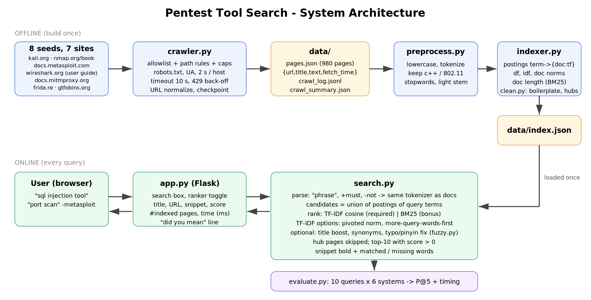
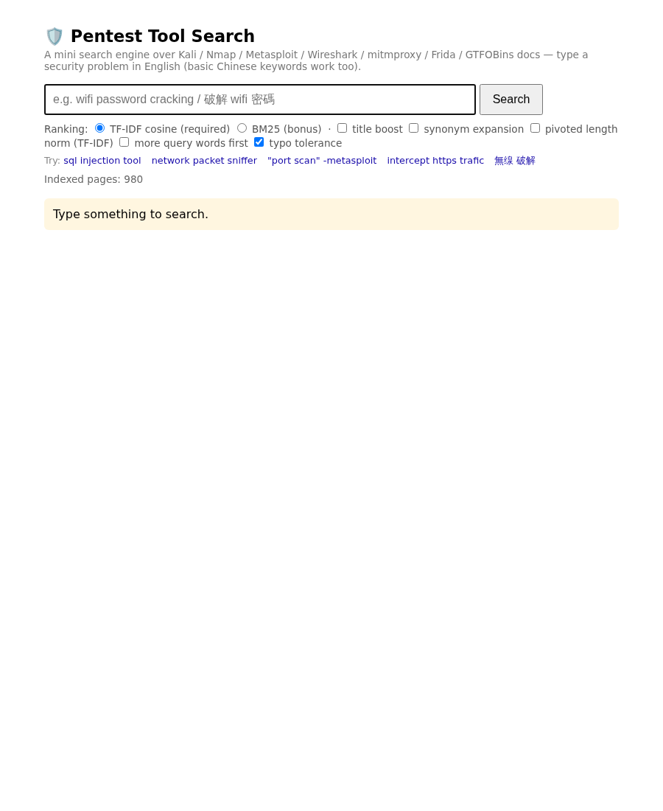
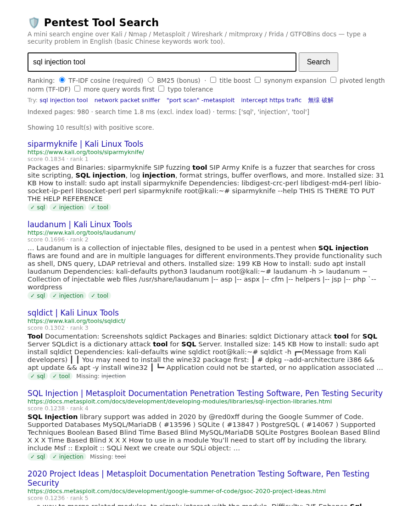
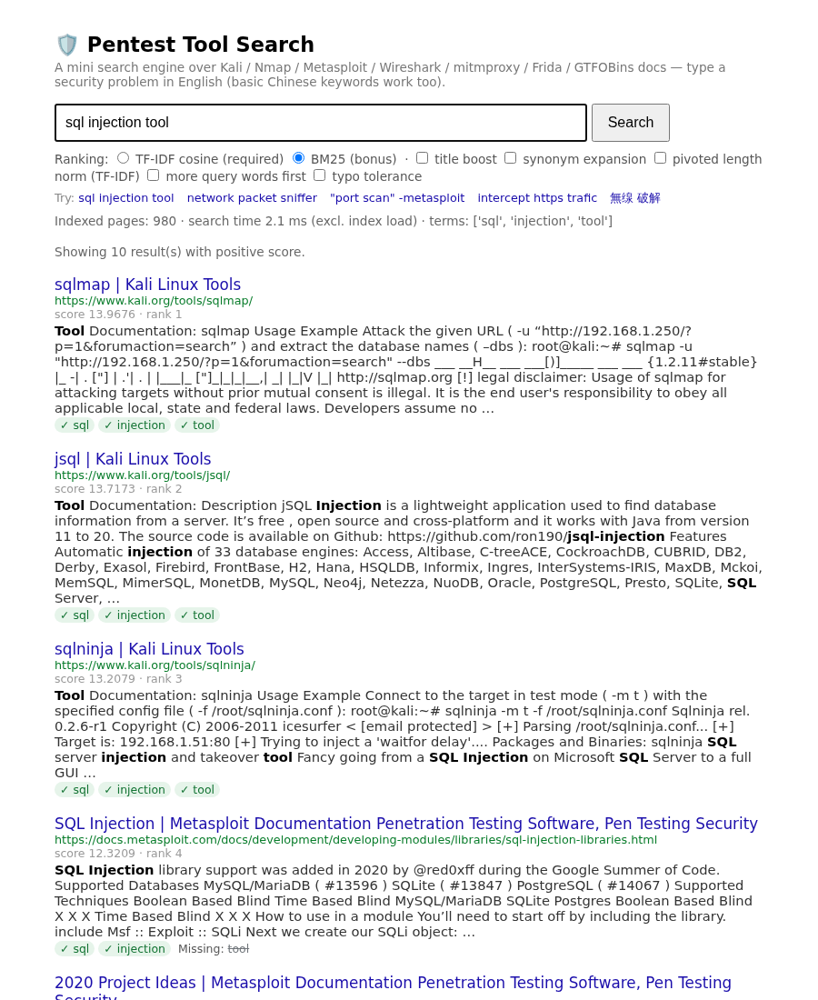
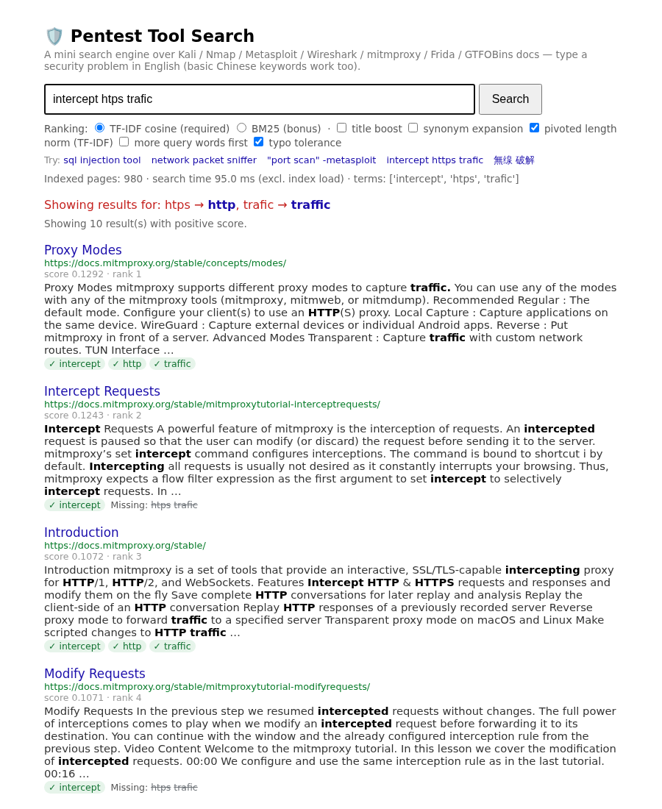
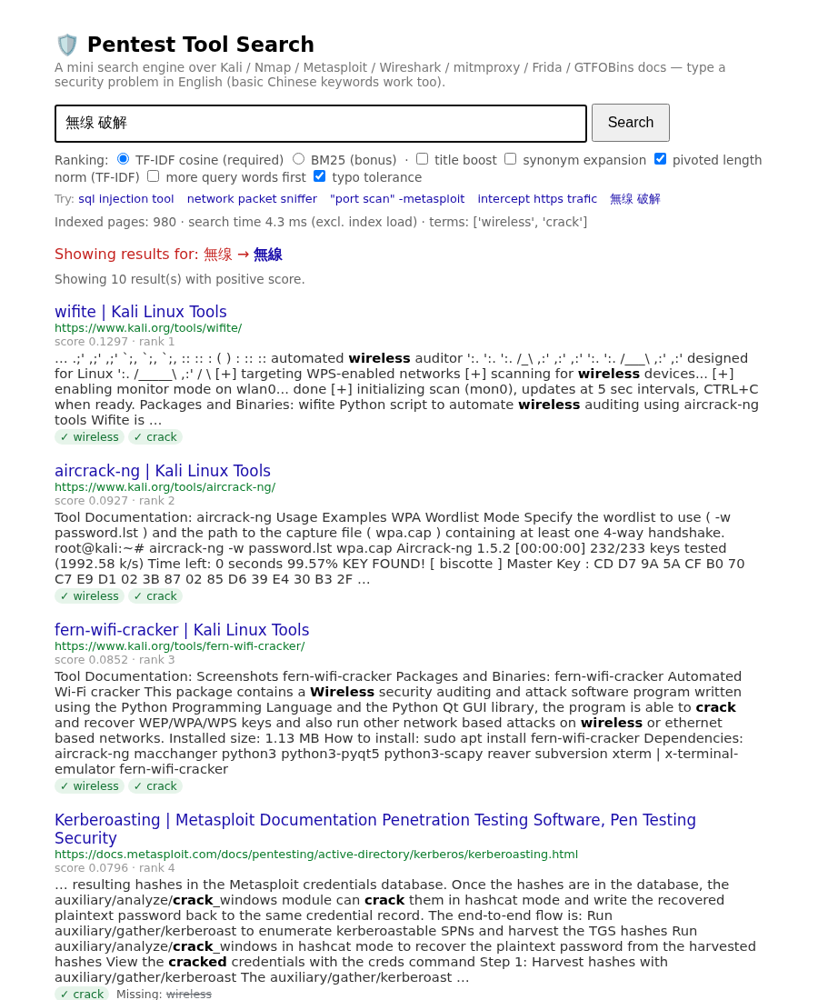
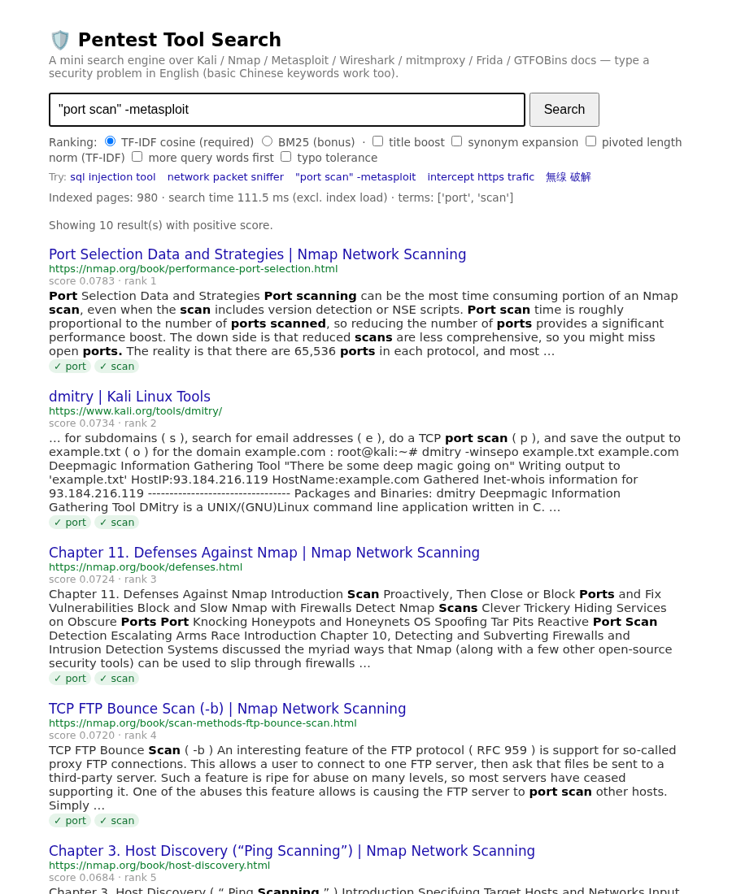
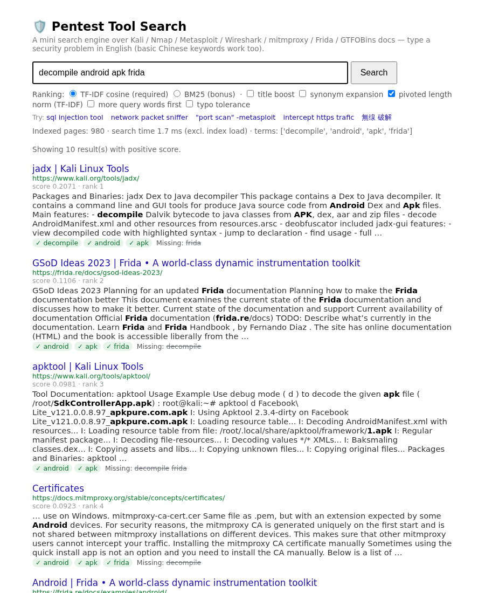
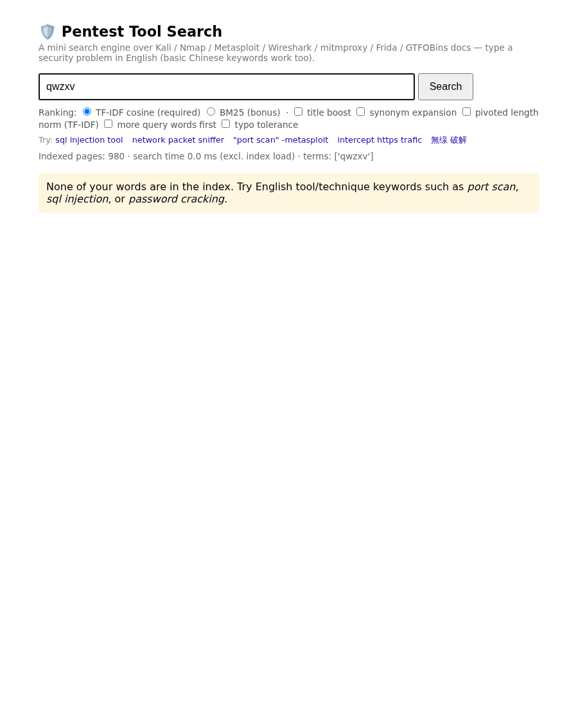

# Term Project I：Web Search Engine — 滲透測試工具搜尋引擎

> 這份初稿裡的數字、表格、截圖都是最終版（v7.1，2026-10-21）。組員只需要補【待補】：組別、姓名、分工、個人心得，也可以自由改寫文字。

組別：【待補】　組員：【待補】　繳交日期：2026-11-05

---

## 1. 主題與目標

使用者用英文描述資安需求（例如 `sql injection tool`、`intercept https traffic`、`decompile android apk`），系統從 7 個資安工具官方文件站中，找出最適合的工具頁或教學頁：Kali Linux 工具頁與文件、Nmap 官方書、Metasploit 文件、Wireshark 使用手冊、mitmproxy、Frida、GTFOBins。

主題範圍是「滲透測試工具與方法」：掃描、Web 攻擊、密碼與 Wi-Fi 破解、封包攔截與分析、HTTPS 中間人、Android App 反編譯、反向 shell 與後滲透。這是一個**搜尋引擎**：只回傳公開文件頁面，不執行任何攻擊。

## 2. 系統架構

- **離線（只建一次）**：`crawler.py` 從 8 個 seed 開始爬 → `data/pages.json`（980 頁）→ `clean.py` 清掉網站樣板文字、標記導覽頁 → `preprocess.py` 斷詞 → `indexer.py` 建倒排索引 → `data/index.json`
- **線上（每次查詢）**：瀏覽器 → `app.py`（Flask）→ `search.py` 用索引找候選頁、排序、產生摘要 → 回傳前 10 名
- **評估**：`evaluate.py` 跑 10 個凍結查詢、6 個系統，共用同一份標註算 P@5 和查詢時間

## 3. 爬蟲

### 3.1 範圍
| 項目 | 設定 |
|---|---|
| Seed（8 個） | kali.org/tools/、kali.org/docs/、nmap.org/book/toc.html、docs.metasploit.com/、wireshark.org/docs/wsug_html_chunked/、docs.mitmproxy.org/stable/、frida.re/docs/home/、gtfobins.org/ |
| Allowlist（7 個 host，不含其他子網域） | `www.kali.org`、`nmap.org`、`docs.metasploit.com`、`www.wireshark.org`、`docs.mitmproxy.org`、`frida.re`、`gtfobins.org` |
| 路徑限制 | Kali 只收 `/tools/`、`/docs/`（排除 nethunter、arm、installation、virtualization、usb、cloud）；Nmap 只收 `/book/`；Metasploit 排除 `/api/`；Wireshark 只收使用手冊；mitmproxy 只收 `/stable/`（排除 `/stable/api/`）；Frida 只收 `/docs/` |
| 每站上限（總和 ≤ 1,000） | Kali 430、Nmap 150、Metasploit 150、Wireshark 80、mitmproxy 50、Frida 40、GTFOBins 100 |

選站原則：都是工具的**官方文件**、用我們的 User-Agent 實測 robots.txt 允許、沒有 Cloudflare 驗證或 403。HackTricks、OWASP MASTG 實測出現 Cloudflare challenge，所以不收。

### 3.2 禮貌與安全
- 每個 host 用我們的 User-Agent 讀 robots.txt 並遵守；User-Agent：`NUK-IR-SearchEngine/1.0 (course project; contact: …)`
- 同一 host 兩次請求至少間隔 2 秒（robots 的 Crawl-delay 更久就照做）；各 host 輪流（round-robin），間隔可以重疊
- timeout 10 秒；總嘗試上限 2,500 次；遇到 429 依 `Retry-After` 等待（最多 60 秒），不重試同一個 URL
- 轉址後重新檢查範圍；非 HTML、太短（< 200 字元）、轉址後重複的 URL、正文完全重複都會跳過並記錄
- URL 正規化：相對轉絕對、去掉 `#fragment`、scheme/host 小寫、去預設埠、**保留 query string**
- 連結從**整頁**抽取（有些網站只在側欄放章節連結），正文則先移除 script/style/nav/header/footer/form/aside，再取 main/article
- 回應沒有標示 charset 時，用自動偵測的編碼解碼（避免 UTF-8 被當成 Latin-1）
- 每 25 頁存一次 checkpoint，可用 `--resume` 續爬

### 3.3 統計（`data/crawl_summary.json`）
| 項目 | 數值 |
|---|---|
| 嘗試次數（實際發出的請求，含失敗） | 1,016 |
| 有效頁面 | **980** |
| 各 host | Kali 430、Nmap 150、Metasploit 150、Wireshark 80、mitmproxy 30、Frida 40、GTFOBins 100 |
| 失敗（連線錯誤或非 200） | **0**；429 限流 0 次 |
| 跳過（有發請求） | 太短 31、非 HTML 1、轉址後重複 4 |
| 未發請求就跳過 | 超過單站上限 1,075 |
| 平均正文長度 | 8,910 字元 |
| 索引詞數 | 58,683 |

1,016 = 980 有效 + 31 太短 + 1 非 HTML + 4 重複。

## 4. 前處理與計分定義

### 4.1 前處理（文件和查詢共用 `preprocess.py`）
- 全部轉小寫
- Token：英數字串，**詞中**可含 `+ - . / #`，所以 `c++`、`802.11`、`wifi-cracking` 不會被切壞
- 複合詞同時保留整體和拆開的部分：`machine-learning` → `machine-learning`、`machine`、`learning`，不會黏成 `machinelearning`；`C++` → `c++`，不會變成 `c`
- 停用詞：一份小型英文清單（冠詞、介系詞、助動詞等），資安術語不移除
- 輕量詞幹還原（自己寫的，Porter 第一步的小子集）：`scanning/scans → scan`、`vulnerabilities → vulnerability`、`cracking → crack`；只處理長度 > 4 的純英文字，所以 `aircrack-ng`、`802.11` 不受影響；`ss/us/is` 結尾不去 s（`pass`、`status`、`analysis`）
- 建索引前用 `clean.py` 移除網站樣板文字：Kali 每頁的 OffSec 課程廣告和上一頁/下一頁導覽、GTFOBins 的 GitHub 按鈕、mitmproxy 的 "Edit on GitHub" 等（爬下來的原始資料不改）
- 標題和正文一起索引

### 4.2 TF-IDF 與 cosine（必做，系統預設）
- tf(t,d) = 1 + log10(count(t,d))，沒出現為 0
- idf(t) = log10(N / df(t))，N = 980，不做平滑
- w(t,d) = tf × idf；查詢向量用同一公式和**同一份語料 idf**，不會每次查詢重算
- cosine(q,d) = Σ w(t,q)·w(t,d) / (‖q‖·‖d‖)，‖d‖ 在建索引時預先算好
- 候選文件 = 查詢詞 postings 的聯集；回傳分數 > 0 的前 10 名
- 導覽頁（只列出其他頁連結的目錄頁，例如 Kali 全部工具列表、Metasploit 各章節的 "Table of contents" 頁，共 12 頁）保留在資料集中，但不當成搜尋結果
- 查詢詞不在詞彙表中（OOV）直接忽略；全部 OOV 時顯示提示

小例子：`python code/toy_example.py` 用 3 篇小文件一步步印出 tokens、倒排索引、IDF、權重、norm、cosine（附錄 A）。

### 4.3 TF-IDF 的兩個改進版本（可切換，用來分析必做系統的弱點）
- **Pivoted length normalization**（Singhal et al., 1996）：分母從 ‖d‖ 改成 (1 − s)·avg‖d‖ + s·‖d‖，s = 0.2。目的是減少 cosine 對短頁的偏好。
- **查詢詞覆蓋優先**（coordination-level ranking）：包含越多個不同查詢詞的頁面排越前面，同一組內仍用 TF-IDF cosine 排序。分數本身不變，類似一般搜尋引擎預設的 AND。

### 4.4 加分：BM25
- k1 = 1.5，b = 0.75，idf = ln(1 + (N − df + 0.5) / (df + 0.5))
- 用同一組查詢、同一份標註和 TF-IDF 比較

### 4.5 其他功能（介面可勾選）
- 標題加權：score × (1 + 0.5 × 標題中出現的查詢詞數)
- 同義詞擴展：查詢端加入同義詞，權重 0.5（原詞 1.0）；附小型中文→英文關鍵字表（例如「破解 → crack」「無線 → wireless」）。語料是英文，所以沒有中文斷詞，表外的中文字視為 OOV
- **打錯字 / 選錯字容錯**（`fuzzy.py`，介面預設開啟）：查詢字不在詞彙表時，英文用 Damerau-Levenshtein 編輯距離（最多 2 次編輯）找最接近的詞，中文用拼音比對中文關鍵字表；修正後的字以權重 0.7 加入查詢，並顯示「Showing results for: injetcion → injection」
- **命中 / 缺少關鍵字**：每筆結果列出包含哪些查詢詞、缺少哪些（類似 Google 的 "Missing:"），摘要中的查詢詞用粗體標示

## 5. 搜尋介面
Flask 單頁：搜尋框、排序方式切換（TF-IDF / BM25）、各功能勾選框、範例查詢。每筆結果顯示標題（連到原頁）、URL、約 80 字摘要（查詢詞粗體）、分數、名次、命中/缺少的關鍵字；頁面顯示已索引頁數（980）、查詢時間和實際使用的查詢詞。Jinja 自動跳脫 HTML，只顯示 http/https 連結。

## 6. 搜尋案例

| # | 查詢 | 設定 | 前三名 | 說明 | 截圖 |
|---|---|---|---|---|---|
| 1 | `decompile android apk` | TF-IDF | jadx、apktool、bytecode-viewer | 全是 APK 反編譯工具 | `screenshots/07_missing_keywords.png`（加了 frida 一詞，看 Missing 標籤） |
| 2 | `sql injection tool` | TF-IDF vs BM25 | TF-IDF：siparmyknife、laudanum、sqldict；BM25：**sqlmap**、jsql、sqlninja | 同一查詢，BM25 把最經典的工具排第一（見 8.1） | `02_tfidf_sql_injection.png`、`03_bm25_sql_injection.png` |
| 3 | `"port scan" -metasploit` | TF-IDF | Nmap 書 Port Selection、dmitry、Nmap 書 Defenses | 片語 + 排除；結果沒有 Metasploit 頁 | `06_phrase_boolean.png` |
| 4 | `intercept htps trafic` | TF-IDF + pivot + 容錯 | Proxy Modes、Intercept Requests、Introduction（都是 mitmproxy） | 兩個打錯字被修成 http、traffic | `04_typo_did_you_mean.png` |
| 5 | `無缐 破解` | TF-IDF + pivot + 容錯 | wifite、aircrack-ng、fern-wifi-cracker | 「缐」是選錯字，用拼音修成「無線」，再對應到 wireless crack | `05_chinese_ime_fix.png` |
| 6 | 空查詢 / `qwzxv` | — | 無 | 分別顯示 "Type something to search." 和 "None of your words are in the index."，不會出錯 | `01_home.png`、`09_no_match_oov.png` |

### 6.1 介面截圖

## 7. 評估：Precision@5

### 7.1 方法
- 10 個查詢在看結果前凍結，每題有資訊需求和相關性規則（`code/evaluate.py`）。因為資料集擴大到 7 站，在看任何新結果之前換掉 3 題：`password hash cracking`（和 wifi 破解太像）→ `intercept https traffic`；`brute force login` → `decompile android apk`；`wireless deauthentication attack`（每個系統都 1.00，分不出好壞）→ `reverse shell payload`。
- 6 個系統各取前五名，合併成 **144 組**不重複的（查詢, 頁面），每組依**頁面內容**判 1/0 並寫理由（`data/eval_judgments.csv`）；模稜兩可的 35 筆做了第二輪複查（3 筆改判，理由寫在 reason 欄）
- P@5 = 前五名相關數 / 5（分母固定為 5，不足五筆當作不相關），再取 10 題算術平均
- 重現方式：`python evaluate.py --score`（使用附上的索引快照）

### 7.2 結果（`data/eval_results.csv`）
| 查詢 | TF-IDF cosine（必做） | TF-IDF + 覆蓋優先 | TF-IDF + pivot | TF-IDF + pivot + 覆蓋 | BM25 | BM25 + 標題 + 同義詞 |
|---|---|---|---|---|---|---|
| wifi password cracking | 0.40 | 0.60 | 1.00 | 0.60 | 0.80 | 0.80 |
| sql injection tool | 0.20 | 0.80 | 0.60 | 0.80 | 0.60 | 0.80 |
| port scanning techniques | 0.20 | 0.40 | 0.80 | 0.80 | 0.60 | 0.80 |
| intercept https traffic | 0.60 | 1.00 | 1.00 | 0.80 | 1.00 | 0.80 |
| web application vulnerability scanner | 0.80 | 0.60 | 0.80 | 0.60 | 0.60 | 0.40 |
| network packet sniffer | 0.80 | 1.00 | 1.00 | 1.00 | 1.00 | 0.80 |
| exploit metasploit module | 0.20 | 0.40 | 0.80 | 0.80 | 0.80 | 0.80 |
| decompile android apk | 0.80 | 0.80 | 0.80 | 0.80 | 0.80 | 1.00 |
| directory enumeration web server | 0.40 | 0.80 | 0.60 | 0.80 | 0.80 | 0.60 |
| reverse shell payload | 0.20 | 0.80 | 1.00 | 1.00 | 1.00 | 0.60 |
| **平均** | **0.46** | **0.72** | **0.84** | **0.80** | **0.80** | **0.74** |

重點：
- 必做的純 TF-IDF cosine 是 0.46。只改一件事（長度正規化，pivot）就到 0.84，是六個系統最高，比 BM25（0.80）還高。這說明純 cosine 最大的弱點是**偏好短頁**，不是 TF-IDF 權重本身。
- 「覆蓋優先」不改分數、只要求多數查詢詞要出現，也能把 0.46 拉到 0.72。
- 兩個改進一起用（0.80）沒有比只用 pivot（0.84）好：改進不一定能疊加。
- 消融實驗（`experiments/v7_1_ablation.json`）：不顯示導覽頁讓「覆蓋優先」從 0.68 → 0.72、BM25 從 0.76 → 0.80；純 TF-IDF 維持 0.46（導覽頁被拿掉後，空出來的位置又被其他短頁占走）。

### 7.3 查詢時間（加分，`data/timing_summary.json`）
計時邊界：`search()` 內，從收到查詢字串到產生含摘要的前 10 名；不含載入索引、Flask 渲染、網路。每題先暖機 1 次，再跑 20 次。

| 系統 | 平均 | 中位數 | 最大 |
|---|---|---|---|
| TF-IDF（必做） | 1.18 ms | 1.08 ms | 4.38 ms |
| TF-IDF + 覆蓋優先 | 2.13 ms | 2.05 ms | 3.21 ms |
| TF-IDF + pivot | 2.31 ms | 2.16 ms | 4.07 ms |
| TF-IDF + pivot + 覆蓋 | 3.00 ms | 3.09 ms | 4.68 ms |
| BM25 | 1.92 ms | 1.51 ms | 3.99 ms |
| BM25 + 標題 + 同義詞 | 2.37 ms | 2.52 ms | 3.25 ms |

片語查詢要對候選頁全文做比對，`"port scan" -metasploit` 約 100 ms；有打錯字的查詢要做編輯距離比對，約 20–90 ms。

## 8. 弱查詢分析（以必做的 TF-IDF cosine 為主）

### 8.1 `sql injection tool`（0.20）：cosine 偏好短頁
前五是 siparmyknife（SIP 模糊測試，順帶提到 SQL injection）、laudanum（web shell 集合）、sqldict、Metasploit 的 SQL Injection 開發函式庫頁、GSoC 2020 計畫頁。sqlmap 不在前五：它的頁面有 600 多個詞，含大量 `--help` 輸出，‖d‖ 很大；siparmyknife 只有 63 個詞，`sql`、`injection`、`tool` 都出現就被放大。BM25 的長度正規化較溫和、tf 會飽和，第一名就是 sqlmap；pivot 也把 sqlmap 拉到第一。

### 8.2 `reverse shell payload`（0.20）：短頁 + 網站結構
前五有三頁是 GTFOBins 的 cowsay、cowthink、cpan（69–76 個詞）。這些程式本身沒有反向 shell 指令，只是「繼承 perl 的功能」，頁面上列出 `Shell`、`Reverse shell` 標籤。頁面很短，`reverse`、`shell` 兩個詞就讓 cosine 很高，但它們都**缺少** `payload`。開「覆蓋優先」後三頁都掉出前五（0.80），pivot 則是 1.00。這也是介面加上「Missing:」標籤的原因：使用者一眼就能看出這三頁缺了 payload。

### 8.3 `exploit metasploit module`（0.20）：低鑑別力的詞
Metasploit 文件幾乎每頁都有 `metasploit` 和 `module`，idf 很低，排序幾乎只靠 `exploit`。結果前五是 GoLang 模組開發、Favorite 指令、文件首頁、"Why CVE is not available"、資料儲存 API，都包含三個詞但不是「如何使用 exploit 模組」。pivot 後出現 "How to use a Metasploit module"、"Running modules"、"Writing an exploit"（0.80）。可能的改善：把網站名當成「站內停用詞」、或對標題加權。

### 8.4 `port scanning techniques`（0.20）：查詢詞太一般
Nmap 書幾乎每章都同時出現 port、scan、technique。前五有 Host Discovery 章、書本導覽 "Intended Audience and Organization"、"Defenses Against Nmap"，它們都談到掃描，卻不是介紹掃描技術本身。真正的 "Port Scanning Techniques" 章節較長，被 cosine 壓下去；pivot 後它排第 2（0.80）。

## 9. 實作挑戰
1. **爬蟲被執行環境中斷**：同 host 間隔 2 秒，上千次請求要 30 分鐘以上，但環境約 20 分鐘就結束。加入 checkpoint 和 `--resume` 分段完成。
2. **單一網站佔滿資料集**：Kali 工具頁上千個，設定每站上限並輪流爬；擴充到 7 站時把 Kali 從 600 降到 430，總量仍 ≤ 1,000。
3. **特殊詞斷詞**：`c++`、`802.11`、`-sS`、`wifi-cracking` 需自訂 tokenizer；詞幹還原也要避開工具名。
4. **新網站連結抽不到**：mitmproxy 的章節連結只放在側欄，而我們先移除導覽列才抽連結，第一次只爬到 3 頁。改成先從整頁抽連結、再移除樣板取正文後，爬到 30 頁。
5. **編碼亂碼**：frida.re 沒有標示 charset，UTF-8 被當成 Latin-1，「•」變成「â¢」。改成用偵測到的編碼，已爬下來的資料用 `fix_encoding.py` 修復。
6. **網站樣板文字污染排序**：Kali 每頁的課程廣告寫著 "SQL Injection" 等攻擊主題，讓 Java 反編譯器 jd-gui 排進 SQL injection 的前五。建索引前用 regex 清掉。
7. **標題加權用加法失敗**：cosine 分數只有 0~1，加固定值會蓋過內容分數；改成乘法。
8. **評估標準太寬鬆**：一開始用「有沒有提到關鍵字」自動標註，P@5 高達 0.96，看不出差異；改成依內容逐筆判斷並寫理由後，純 TF-IDF 只剩 0.4 多。評估方法本身可能是最大的誤差來源。
9. **改進不能疊加**：pivot 單獨 0.84，加上覆蓋優先反而 0.80；必須一次只改一件事、分別量測。
10. **打錯字修正的細節**：索引存的是詞幹（`https` 存成 `http`），`htps` 原本會被修成 `hops`。改成同時比對 `詞幹 + s`，並偏好「把打的字當子序列包住」的候選（少打一個字母是最常見的錯）。
11. **換查詢的公平性**：資料集擴大後換了 3 題。規則是只看主題涵蓋和鑑別度，在看任何新結果之前換好並凍結。

## 10. 組員分工【待補】
| 組員 | 負責 |
|---|---|
| 【姓名】 | 【例：主題發想、seed 網站挑選】 |
| 【姓名】 | 【例：爬蟲、前處理、索引】 |
| 【姓名】 | 【例：搜尋排序、Flask 介面】 |
| 【姓名】 | 【例：相關性標註、評估、報告】 |

## 11. 個人心得【每人各自寫】

## 附錄 A：小例子計分（`python code/toy_example.py`）
文件：d0 = "sqlmap is an sql injection tool"、d1 = "nmap is a port scanning tool"、d2 = "sql injection and sql injection payloads"；查詢 `sql injection tool`。（詞幹還原後 scanning → scan、payloads → payload。）

| 詞 | df | idf = log10(3/df) |
|---|---|---|
| sql、injection、tool | 2 | 0.1761 |
| sqlmap、nmap、port、scan、payload | 1 | 0.4771 |

- ‖d0‖ = 0.5663、‖d1‖ = 0.8450、‖d2‖ = 0.5767、‖q‖ = 0.3050
- cos(q,d0) = 3 × 0.1761² / (0.3050 × 0.5663) = **0.5386**
- cos(q,d2) = 2 × 0.1761 × 0.2291 / (0.3050 × 0.5767) = **0.4587**
- cos(q,d1) = 0.1761² / (0.3050 × 0.8450) = **0.1203**
- 排名：d0 > d2 > d1

## 附錄 B：檔案
`code/`（crawler、config、clean、preprocess、indexer、search、fuzzy、synonyms、app、evaluate、toy_example、fix_encoding、run_experiments、README）、`data/`（pages.json、index.json、crawl_log.jsonl、crawl_summary.json、eval_runs.csv、eval_judgments.csv、eval_results.csv、timing_summary.json）、`experiments/`（各版本結果與消融實驗）、`report/`（架構圖、截圖、本初稿、demo 腳本）、`DEVLOG.md`（開發紀錄）。
